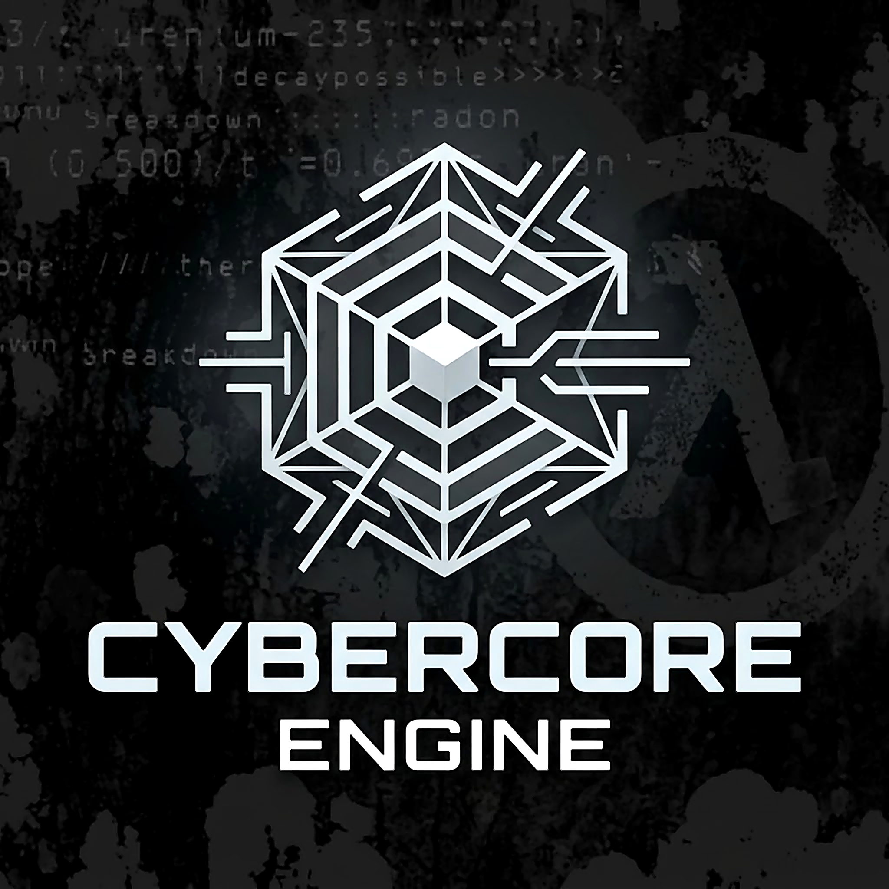

# CyberCore Engine



An Android engine for GoldSrc-based games with Lua scripting built into the engine. It is a build of [Xash3D FWGS](https://github.com/FWGS/xash3d-fwgs) with an embedded Lua 5.5 runtime.

## Supported games

| Game | Folder |
|---|---|
| Half-Life | `valve` |
| Opposing Force | `gearbox` |
| Counter-Strike | `cstrike` |
| Condition Zero | `czero` |

Game files are not included. Copy them from your own copy of each game into the matching folder.

## Folder layout

The app creates these folders inside the game folder selected in its settings, every time it is opened. Existing files are never touched, and `addons` stays empty.

```
valve/
├── lua/
│   ├── autorun/
│   │   ├── client/
│   │   └── server/
│   ├── includes/
│   ├── entities/
│   ├── weapons/
│   ├── effects/
│   ├── vgui/
│   └── menu/
└── addons/
    └── CustomAddon/
        ├── addon.json
        └── lua/
            ├── autorun/
            ├── entities/
            └── weapons/
```

`gearbox`, `cstrike` and `czero` use the same layout.

## Script loading

Scripts are read from disk when the game starts, so editing a `.lua` file never needs a rebuild. The console command `lua_reload` reloads everything without restarting.

Load order:

1. Built-in engine scripts
2. `<game>/lua/autorun/*.lua`, then `server/`, then `client/`
3. For each folder in `<game>/addons/`, the same three locations

Rules:

- `client/` scripts are skipped on a dedicated server.
- A failing script is logged and skipped; the rest keep loading.
- A hook that raises an error is removed and logged once.
- An addon is skipped when its `addon.json` contains `"enabled": false`.
- `addons` are scoped per game: `cstrike/addons` only affects Counter-Strike.
- Addon scripts are loaded in place. Mounting addon materials, models, sounds and maps as extra search paths is not implemented yet.

## Logs

`lua.log` is written next to `engine.log` on every launch and contains script errors with file, line and traceback.

## Console commands

| Command | Purpose |
|---|---|
| `lua_reload` | Reload all Lua scripts |
| `lua_run <code>` | Run a Lua string |

Both are restricted, so a server cannot run them on your client.

## Lua API

| Function | Purpose |
|---|---|
| `cc.hook.Add(event, id, fn)` | Register a callback |
| `cc.hook.Remove(event, id)` | Remove a callback |
| `cc.hook.Run(event, ...)` | Run callbacks for an event |
| `cc.settings.Get(key, default)` | Read a saved setting |
| `cc.settings.Set(key, value)` | Save a setting |
| `cc.screen.Width()` / `cc.screen.Height()` | Screen size in pixels |
| `cc.draw.Rect(x, y, w, h, r, g, b, a)` | Filled rectangle, inside `HUDPaint` only |
| `cc.draw.Circle(x, y, radius, segments, thickness, r, g, b, a)` | Circle outline, inside `HUDPaint` only |
| `cc.draw.Text(x, y, text, r, g, b, a)` | Text, inside `HUDPaint` only |
| `cc.draw.TextSize(text)` | Returns width and height, inside `HUDPaint` only |
| `cc.draw.Glyph(sx, sy, sw, sh, x, y, w, h, r, g, b, a)` | Draw a part of the built-in font atlas, inside `HUDPaint` only |
| `cc.draw.GlyphReady()` | True when the font atlas is loaded |
| `cc.draw.SetClip(x, y, w, h)` / `cc.draw.ClearClip()` | Limit drawing to a rectangle, rectangles and sprites are cut at the edge, text is drawn only when fully inside |
| `cc.draw.SpriteLoad(path)` | Load a `.spr`, returns a handle or 0, inside `HUDPaint` only |
| `cc.draw.Sprite(handle, frame, x, y, w, h, sx, sy, sw, sh, r, g, b, a)` | Draw a scaled part of a sprite additively, inside `HUDPaint` only |
| `cc.player.Get()` | Player state: `health`, `armor`, `suit`, `longjump`, `weapons` bit mask, `weapon`, `clip`, `x`, `y`, `z`, `active` |
| `cc.player.HasWeapon(class)` | Whether the player holds the weapon, nil when unknown |
| `cc.player.Ammo(class, second)` | Current and maximum ammo of a weapon, nil when unknown |
| `cc.hd.Available()` / `cc.hd.Enabled()` / `cc.hd.Set(on)` | The `<game>_hd` folder: check it exists, read and change the saved setting |
| `cc.hud.HideTouch(hide)` | Hide or show the on-screen touch buttons, the menu uses it while it is open |
| `cc.icon.Draw(name, x, y, size, color)` | Draw a built-in icon, `cc.icon.Exists(name)` checks a name |
| `cc.hud.HideDefaultCrosshair(hide)` | Hide or show the engine crosshair |
| `cc.fs.Read(path, all)` / `cc.fs.Exists(path)` / `cc.fs.Find(pattern, all)` | Read files inside the game folder, `all` also searches the base game folders |
| `cc.fs.Write(path, data)` | Write to `data/` or `cc_settings.cfg` only |
| `cc.log.Print(text)` / `cc.log.Error(text)` | Write to `lua.log` |
| `cc.Give(class)` | Give a `weapon_`, `ammo_` or `item_` entity to the player, local games only |
| `cc.Map()` | Current map name |
| `cc.Reload()` | Reload all scripts after the current frame |
| `cc.scripts` | List of `{ path, addon, ok }` for every loaded script |
| `cc.addons` | List of `{ name, enabled }` for every addon found |
| `cc.addon.IsEnabled(name)` / `cc.addon.SetEnabled(name, enabled)` | Saved addon switch, applied on the next reload |
| `include(path)` | Run another script from the game folder |

Events: `Initialize`, `HUDPaint`, `Shutdown`, `UserMessage` (name, raw data) for every server message, `Touch` (`"down"`, `"motion"` or `"up"`, finger, x, y in pixels; return `true` to consume the touch).

Globals: `CLIENT`, `SERVER`, `cc.game` (the game folder name).

The Lua sandbox keeps `base`, `coroutine`, `table`, `string`, `math`, `utf8` and the `os` functions `time`, `clock`, `date`, `difftime`. `io`, `package`, `debug`, `dofile` and `loadfile` are not available.

Settings are saved in `cc_settings.cfg` inside the game folder.

## Built-in crosshair

The crosshair is a Lua script compiled into the engine, not a game file or an addon.

- Enabled by default, and hides the engine crosshair while active
- Shapes: `dot`, `cross`, `tee`, `circle`, `square`, `crossdot`, `circledot`
- Adjustable color, opacity, size, thickness and gap, saved between launches
- Games whose client library draws its own crosshair may still show it

```lua
cc.crosshair.Set("shape", "circle")
cc.crosshair.Set("size", 12)
cc.crosshair.Set("color", { r = 255, g = 0, b = 0, a = 255 })
cc.crosshair.Set("enabled", false)
```

## Lua-Menu

A built-in menu compiled into the engine, opened from a button at the top of the screen.

- The button sits in the center by default and can be moved left, center or right in the Settings tab
- Tabs: Weapons, Entities, NextBots, Addons, Scripts, Crosshair, Settings
- The touch buttons are hidden while the menu is open and return when it is closed
- Weapons tab is built per game from the game's own `sprites/weapon_*.txt` files, with the weapon icons read from the game's HUD sprites. Tap a weapon to receive it, tap again for ammo
- Lists are separated by game: Half-Life, Opposing Force (both lists), Counter-Strike (also Condition Zero), and Blue Shift uses the Half-Life list. Each has weapons, ammo and equipment such as armor, health kits, the HEV suit and the long jump module
- Any other `weapon_*.txt` found in the game folder is added under Other weapons
- Items are checked first: nothing is given when armor, health or ammo is already full, when the weapon, HEV suit or long jump module is already owned, when you have no weapon for the ammo, or when you are dead
- Ammo and item icons come from the game's own HUD sprites, with built-in icons only as a fallback
- Giving uses the game's `give` command, so it works only in a local game (single-player or a listen server) and turns `sv_cheats` on for that session
- Second tap on a weapon gives its matching ammo item, on weapons without ammo items it gives the weapon again
- Addons tab lists every addon with an Enable or Disable button and a Reload button; changes apply after a reload
- Scripts tab lists every loaded script and marks failed ones, details are in `lua.log`
- Crosshair tab is one page: shapes and sizes on the left, the live preview with colors and RGB and opacity sliders on the right
- Every tab and many options have icons, available to scripts through the `icon` field of entries and `cc.menu.AddTab(id, title, draw, icon)`
- Icon names: weapons, rifle, melee, grenade, ammo, armor, battery, health, suit, boots, tool, entities, nextbots, addons, scripts, crosshair, settings, spawn, bot, jump
- Closing and opening the menu keeps the same tab and scroll position, and the last tab is remembered between launches
- Settings tab has a switch for the `<game>_hd` content folder when it exists. The change applies when you leave the current game and enter again, by starting a new local game or single player, or loading a save
- Crosshair and Settings tabs have buttons to restore the defaults
- While the menu is open it takes all touches, so the game does not react underneath

Scripts and addons add their own content:

```lua
cc.menu.AddEntry("weapons", {
	name = "My Weapon",
	description = "Short text",
	onClick = function(entry) end,
})

cc.menu.AddTab("mytab", "My Tab", function(ui)
	ui:Label("Hello")

	if ui:Button("Run") then
	end

	local on = ui:Toggle("Option", cc.settings.Get("option", false))
	cc.settings.Set("option", on)

	local size = ui:Slider("Size", cc.settings.Get("size", 5), 1, 20)
	cc.settings.Set("size", size)
end)
```

| Function | Purpose |
|---|---|
| `cc.menu.AddEntry(category, entry)` | Add an item to a category tab, new categories get their own tab |
| `cc.menu.AddTab(id, title, draw)` | Add or replace a tab |
| `cc.menu.RemoveTab(id)` | Remove a tab |
| `cc.menu.SelectTab(id)` | Switch to a tab |
| `cc.menu.GetEntries(category)` | Entries registered for a category |
| `cc.menu.Open()` / `cc.menu.Close()` / `cc.menu.Toggle()` / `cc.menu.IsOpen()` | Control the menu |

Tab widgets: `ui:Label(text)`, `ui:Button(text, subtext)`, `ui:Toggle(text, value)`, `ui:Slider(text, value, min, max)`, `ui:Choice(options, current)`, `ui:Row(text, buttonText)`, `ui:Section(title)`, `ui:Empty(text)`, `ui:Preview(height, fn)`, `ui:Grid(count, columns, tileHeight, selected, drawTile)`, `ui:Spacer()`. `ui:Button(text, subtext, primary)` and `ui:Toggle(text, value, subtext)` accept the optional arguments shown.

Clicking an entry runs its `onClick` and the `MenuEntry` event. Entries added to `weapons` appear in an Addons section under the built-in weapon tiles. Spawning entities and NextBots needs engine support that is not implemented yet.

## Project structure

```
CyberCore-Engine/
├── README.md
├── assets/
├── engine/
│   └── common/
│       └── lua/
│           ├── cc_lua.h
│           ├── cc_lua_internal.h
│           ├── core/
│           │   ├── cc_lua.c
│           │   └── prelude.lua
│           ├── api/
│           │   └── cc_api.c
│           └── builtin/
│               └── crosshair.lua
├── 3rdparty/
│   └── lua/
├── android/
└── scripts/
```

This repository only contains the CyberCore changes. The build downloads Xash3D FWGS and Lua, copies these files over them, patches a few lines of the engine, and builds the APK.

## Versions

| Component | Version |
|---|---|
| Xash3D FWGS | commit `707596f4905689ec224e993fcaa4d4ad66aa67d6` |
| Lua | `v5.5.1` |

To update, change `XASH_REF` and `LUA_REF` in `.github/workflows/build.yml`. If the engine changed the lines CyberCore patches, `scripts/prepare.py` stops with a message naming the file.

## Building

GitHub Actions runs the `Build Engine` workflow on every push to `main`. The APK is attached to the run's artifacts and published in the repository's Releases as `v<version>`, a new release for every new version and the same release updated when the version is unchanged.

## Release versions

The version is in the `VERSION` file. The first release is `0.1.0` and every addition raises the last number, `0.1.1`, `0.1.2` and so on. The version is used in the APK file name, the app version and the Settings tab, and Lua scripts can read it from `cc.version`.

## License

GPLv3, following Xash3D FWGS. Xash3D FWGS is by FWGS and Team Xash. Lua is by PUC-Rio under the MIT license.

## Fonts

The menu draws text with a built-in anti-aliased font instead of the engine console font.

| Function | Description |
|---|---|
| `cc.font.Draw(x, y, text, size, color, bold, spacing)` | Draw text, `color` is `{r, g, b, a}`, falls back to the engine font if the atlas is missing |
| `cc.font.Width(text, size, bold, spacing)` | Text width in pixels |
| `cc.font.Height(size, bold)` | Line height in pixels |

The atlas is `engine/common/lua/assets/font.pgm` with its metrics in `builtin/fontdata.lua`, both generated by `scripts/make_font.py`.

The glyphs are rendered from Inter, copyright The Inter Project Authors, licensed under the SIL Open Font License 1.1.

## World API

Read-only access to the running game, available in local games and on servers. Every function returns empty results when no map is running.

| Function | Description |
|---|---|
| `cc.world.Active()` | True when a map is running locally |
| `cc.world.Info()` | `map`, `maxplayers`, `singleplayer`, `skill`, `deathmatch`, `coop`, `teamplay`, `time` |
| `cc.world.Entities(kind)` | List of entities, `kind` is `"player"`, `"monster"` or `"entity"`, empty for all |
| `cc.world.Entity(index)` | Full entity details: name, class, health, max health, armor, alive, origin, angles, bounds, model, sequence, player model and team |
| `cc.world.Hitboxes(index)` | Body parts: `head`, `neck`, `chest`, `stomach`, `left_arm`, `right_arm`, `left_leg`, `right_leg` with the world position and size of each |
| `cc.world.Players()` / `cc.world.Monsters()` | Shortcuts for the lists above |
| `cc.world.Classify(entity)` | `player`, `friend`, `enemy`, `creature`, `vehicle` or `entity`, decided from the class name |
| `cc.world.HitMultiplier(kind, hit)` | Damage multiplier of a body part from the skill cvars, `kind` is `"player"` or `"monster"` |
| `cc.world.Describe(index)` | Entity details, category and hitboxes with multipliers together |
| `cc.cvar.Get(name)` / `cc.cvar.GetString(name)` | Read a cvar, password and rcon cvars are refused |

Hitbox positions are computed from the model bones and are approximate. Counter-Strike uses its own damage rules, so multipliers are only available where the game defines them as cvars.

The Settings tab has a "Write player report" button that saves the weapon ownership and ammo state to lua.log.
